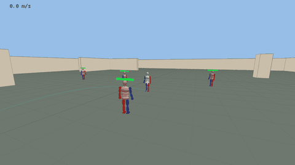
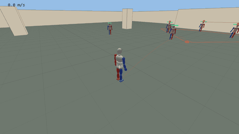
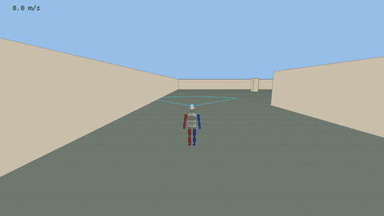
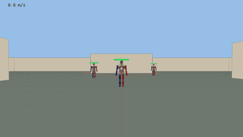

# tankfist-rs

Overwatch's Doomfist rebuilt in Rust, tick for tick. Nearly every number was measured from
Overwatch with Workshop logging scripts and checked by replaying the logged inputs through the
Rust version.

The character is a built-in mannequin with keyframed animations, all generated in code.

| Rocket Punch into a wall slam | Seismic Slam with the landing preview |
|---|---|
|  |  |
| **Punch, jump cancel, slam** | **Hand Cannon and quick melee** |
|  |  |

The character is an original test-dummy mannequin made in code; no Overwatch art is used. The
GIFs are scripted runs of the playable demo (`python scripts/make_gifs.py` remakes them).

## Play it

Needs [Rust](https://rustup.rs). Then:

```bash
cargo run --release --bin bean
```

Mouse look, WASD, Space jump, right mouse Rocket Punch (hold to charge), Shift Seismic Slam,
E Power Block, V quick melee, left mouse Hand Cannon. Tab third person, T slow motion, R reset, H respawn dummies,
F record, Esc mouse, [ and ] change sensitivity.

G toggles the slam preview: the leap's path and the landing hit cone, red when it would hit
a dummy (marked with a red dot).

All keys can be changed in `bean_settings.txt`. Mouse sensitivity and FOV use Overwatch's numbers and are saved in `bean_settings.txt`
(`sensitivity = 5`, `fov = 103` by default; this file is git-ignored).

## What's in it

| Path | What it is |
|---|---|
| `src/abilities/` | Movement, passive, Power Block, Rocket Punch, Seismic Slam (one file each) |
| `src/tunables.rs` | Every number, tagged `[measured <date>]`, `[partly measured]` or `[guess]` |
| `src/doomfist.rs`, `src/world.rs` | Shared state, tick order, dummies and their knockback |
| `src/log.rs`, `src/replay.rs` | Read Workshop logs; replay their inputs through the sim |
| `src/playback.rs`, `src/record.rs` | Turn any recording into a Workshop playback script; write logs from the sim |
| `src/bin/bean/` | Playable 3D test map, mannequin model and animations |
| `src/bin/analyze.rs` | Summaries and tables for Workshop logs |
| `src/bin/compare.rs` | Line up two runs (or the sim against a log) and show where they split |
| `workshop/` | Workshop scripts: manual logger, automatic test suites, playback |
| `logs/` | Not in the repo. Put Overwatch logs here; the replay tests use them when present and skip otherwise |
| `tests/` | Ability tests plus replays of real logs that must keep matching |

## Help test it

Two ways, both through [Issues](../../issues/new/choose):

- **Record Overwatch logs.** Paste one of the `workshop/` scripts into a custom game, play, and
  attach the log file to a **Log submission** issue. Step-by-step:
  [docs/submitting-logs.md](docs/submitting-logs.md). Logs are numbers only.
- **Play the Rust version** and open a **Bug / feels wrong** issue when something doesn't match
  Overwatch. Pressing F in bean records your run (you, the dummies and all damage) to
  `logs/bean-*.txt`; attach that too.

To check a log yourself:

```bash
cargo run --bin analyze -- path/to/Log-....txt
```

```bash
cargo run --bin compare -- sim path/to/Log-....txt --ow-take 1
```

## Status

Measured and replaying within a few cm of Overwatch: walking, jumping, air control, Rocket Punch
(charge, dash, jump cancel and camera boost, airborne punches), Seismic Slam (aim, steering, bunny
hop, re-press cancel), Power Block, empowered punch, passive temporary health, hit damage,
knockback and wall slams.

Also measured: Hand Cannon (11 pellets, fire rate, auto refill, falloff), quick melee, punch
splash. Not built yet: Meteor Strike, surface-angle bounce tech.

## Disclaimer

A fan project for studying game mechanics. Not affiliated with or endorsed by Blizzard
Entertainment. Overwatch and Doomfist are trademarks of Blizzard Entertainment. No game files,
models, sounds or code from Overwatch are in this repository.

## License

MIT, see [LICENSE](LICENSE). The disclaimer above still applies to the names.
